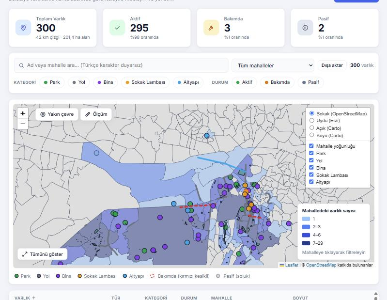
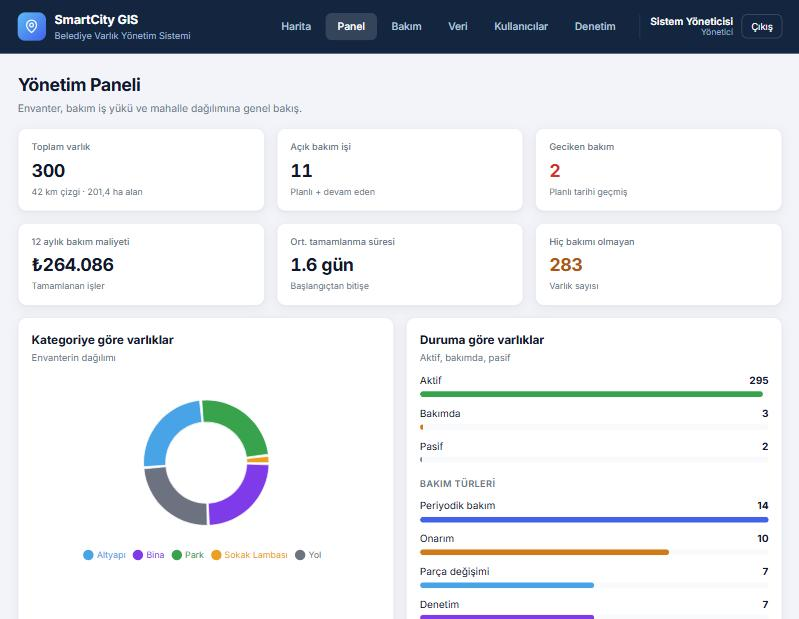
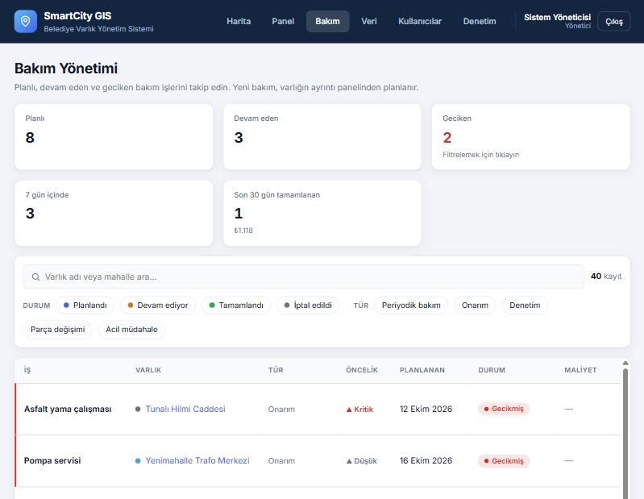
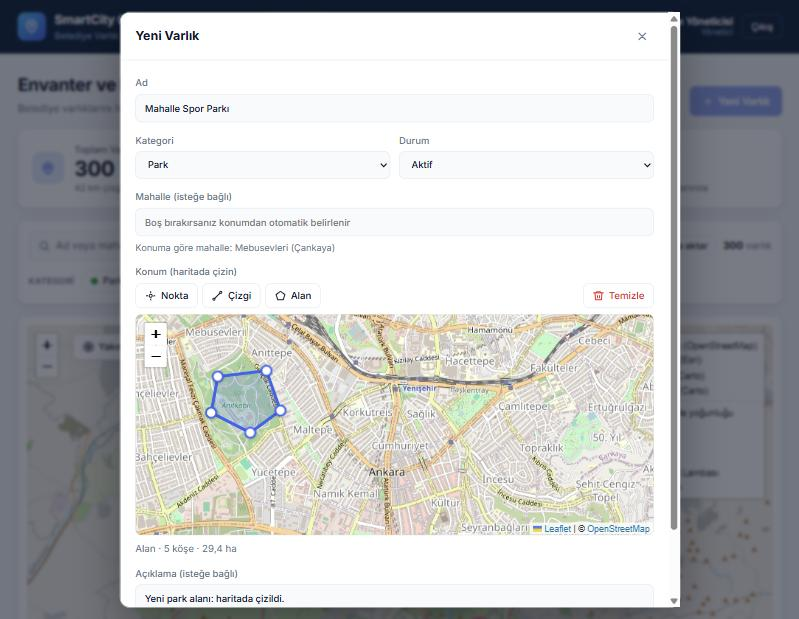
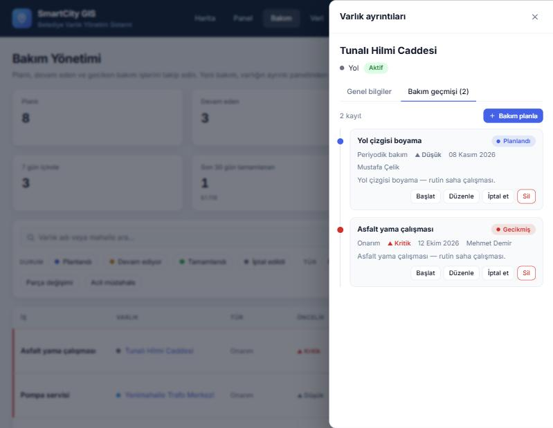
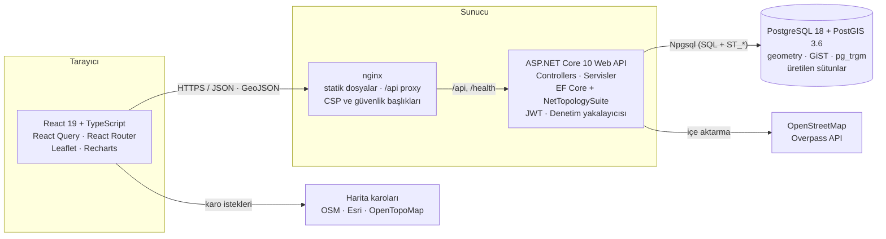
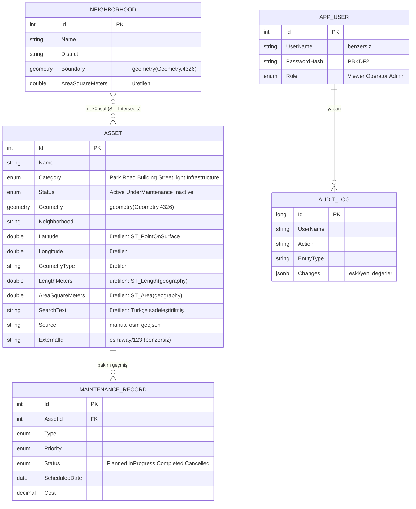

# SmartCity GIS: Belediye Varlık Yönetim Sistemi

[](https://github.com/Eccekurtt/SmartCityGIS/actions/workflows/ci.yml)


Bir belediyenin parklar, yollar, binalar, sokak lambaları ve altyapı varlıklarını **harita üzerinde** kaydettiği,
sorguladığı, bakımını planladığı ve raporladığı tam yığın (full-stack) bir **CBS (Coğrafi Bilgi Sistemi)** web
uygulaması. Geometriler (nokta, çizgi, alan) **PostGIS** ile saklanır; uzunluk, alan, mesafe ve mahalle ataması
veritabanında, mekânsal sorgularla hesaplanır.



## İçindekiler

- [Özellikler](#özellikler)
- [Mimari](#mimari)
- [Veri modeli](#veri-modeli)
- [Hızlı başlangıç (Docker)](#hızlı-başlangıç-docker)
- [Yerel geliştirme](#yerel-geliştirme)
- [API özeti](#api-özeti)
- [CBS / PostGIS notları](#cbs--postgis-notları)
- [Güvenlik](#güvenlik)
- [Test stratejisi](#test-stratejisi)
- [Tasarım kararları ve takaslar](#tasarım-kararları-ve-takaslar)
- [Sınırlamalar ve yol haritası](#sınırlamalar-ve-yol-haritası)
- [Veri kaynakları ve lisanslar](#veri-kaynakları-ve-lisanslar)

## Özellikler

**Harita ve envanter**
- Nokta, çizgi ve alan geometrileri; kategoriye göre renk, duruma göre stil (bakımda = kırmızı kesikli, pasif = soluk)
- **Haritadan çizim**: form içinde nokta/çizgi/alan çizme, köşe sürükleyerek düzenleme, canlı uzunluk/alan ölçümü
- Kategori katmanları, 5 altlık harita (sokak, uydu, açık gri, koyu gri, topografya), tablo ↔ harita seçim senkronu
- **Mahalle yoğunluk haritası** (koroplet): 468 gerçek mahalle sınırı, kantil sınıflı lejant, tıklayınca filtre
- **Yakın çevre analizi**: haritada bir noktaya tıkla, yarıçap kaydırıcısıyla (PostGIS `ST_DWithin`, metre) çevredeki varlıklar
- **Ölçüm aracı**: jeodezik mesafe ve alan
- Türkçe karakter duyarsız arama (`KIZILAY` = `Kızılay`), çoklu filtre, sıralama, sunucu tarafı sayfalama

**Bakım ve raporlama**
- Bakım kayıtları (varlık : bakım = 1 : N), durum makinesi *Planlandı → Devam ediyor → Tamamlandı / İptal*
- Bakım başlayınca varlık otomatik **"Bakımda"**, bitince **"Aktif"** olur (başka devam eden iş yoksa)
- Gecikmiş işler, yaklaşan 7/14 gün, maliyet, ortalama tamamlanma süresi
- Yönetim paneli: KPI kartları, kategori/durum dağılımı, mahalle bazında ilk 10, aylık bakım adedi ve maliyet trendi

**Kurumlar arası veri entegrasyonu**
- **GeoJSON dışa aktarma** (QGIS/ArcGIS'e doğrudan açılır) ve **CSV** (Excel için UTF-8 BOM, `;` ayraçlı)
- **GeoJSON içe aktarma**: önce doğrulama (kuru çalıştırma) raporu, sonra aktarım; Türkçe/İngilizce alan adları
- **OpenStreetMap içe aktarma** (Overpass API): ilçe seç, park / yol / kamu binası / altyapı çek; yinelenenler atlanır
- Konumdan **otomatik mahalle belirleme** (`ST_Intersects`)

**Güvenlik ve izlenebilirlik**
- JWT kimlik doğrulama, 3 rol (İzleyici / Operatör / Yönetici), sunucu tarafında yetki denetimi
- **Denetim kaydı**: kim, ne zaman, neyi, eski ve yeni değerlerle değiştirdi (aynı işlemde, değiştirilemez)
- Kullanıcı yönetimi, giriş denemelerine hız sınırı, PBKDF2 ile tuzlanmış parola özeti

**Mühendislik**
- 78 backend + 47 frontend test; entegrasyon testleri gerçek PostGIS konteynerinde (Testcontainers)
- GitHub Actions CI, çok aşamalı Docker imajları, `docker compose up` ile tek komut kurulum
- OpenAPI + Scalar arayüzü, sağlık ucu (`/health`), ProblemDetails ile tutarlı hata yanıtları, Türkçe doğrulama mesajları
- Açık/koyu tema, mobil uyumlu, kod bölme (sayfa başına yükleme)

| | |
|---|---|
|  |  |
|  |  |

## Mimari



**Katmanlar ve sorumlulukları**

| Katman | Teknoloji | Sorumluluk |
|---|---|---|
| Arayüz | React, TypeScript, Leaflet | Gösterim, çizim, etkileşim. Veriyi kendisi tutmaz; React Query ile sunucudan okur, önbellekler. |
| API | ASP.NET Core Controller'ları | HTTP sözleşmesi, doğrulama, yetki, iş kuralları (bakım durum makinesi, mahalle ataması). |
| Veri erişimi | EF Core + Npgsql + NetTopologySuite | LINQ → SQL çevirisi, migration'lar, geometri tipleri. |
| Veritabanı | PostgreSQL + PostGIS | Kalıcılık, mekânsal hesaplar (uzunluk, alan, mesafe, kesişim), indeksler. |

İstek akışı örneği: haritada bir lambaya tıklama → React `GET /api/assets/42` → nginx → Controller → EF Core
`SELECT ...` (PostGIS üretilen sütunlarıyla) → JSON (geometri GeoJSON olarak) → popup.

## Veri modeli



## Hızlı başlangıç (Docker)

Gereken: Docker Desktop (veya Docker Engine + Compose).

```bash
git clone https://github.com/Eccekurtt/SmartCityGIS.git
cd SmartCityGIS
docker compose up --build
```

İlk derleme birkaç dakika sürer. Hazır olunca **http://localhost:8080** adresini açın. Veritabanı otomatik
oluşturulur, migration'lar uygulanır; 468 mahalle sınırı, örnek varlıklar ve bakım geçmişi yüklenir.

| Kullanıcı | Parola | Rol |
|---|---|---|
| `admin` | `Admin123!` | Yönetici: her şey |
| `operator` | `Operator123!` | Operatör: varlık ve bakım ekler/düzenler |
| `izleyici` | `Izleyici123!` | İzleyici: salt okunur |

> Bu hesaplar yalnızca **demo** içindir (`Seed__DemoUsers=true`). Gerçek bir sunucuda `.env.example` dosyasını
> `.env` olarak kopyalayın, `DB_PASSWORD` ve `JWT_KEY` değerlerini değiştirin, `SEED_DEMO_USERS=false` yapın ve
> ilk yöneticiyi `Seed__AdminUserName` / `Seed__AdminPassword` ile oluşturun.

Gerçek veri için yönetici olarak **Veri** sayfasından bir ilçenin mahalle sınırlarını ve OpenStreetMap
varlıklarını içe aktarabilirsiniz.

## Yerel geliştirme

Gereken: .NET 10 SDK, Node.js 22, PostgreSQL 16+ ve **PostGIS**, Git.

**1. Veritabanı**

```sql
CREATE DATABASE smartcity_gis;
-- PostGIS ve pg_trgm eklentileri migration içinde etkinleştirilir (süper kullanıcı gerekir).
```

**2. Bağlantı dizesi** (parola Git'e girmez, kullanıcı gizli deposunda durur)

```bash
cd backend/SmartCityGis.Api
dotnet user-secrets set "ConnectionStrings:DefaultConnection" "Host=localhost;Port=5432;Database=smartcity_gis;Username=postgres;Password=PAROLANIZ"
```

Geliştirme JWT anahtarı `appsettings.Development.json` içindedir; üretimde `Jwt__Key` ortam değişkeni kullanın.

**3. API'yi çalıştır** (geliştirmede migration ve örnek veri otomatik yüklenir)

```bash
dotnet run --launch-profile http        # http://localhost:5046  (API belgeleri: /scalar)
```

**4. Arayüzü çalıştır**

```bash
cd frontend
npm install
npm run dev                             # http://localhost:5173  (/api isteklerini 5046'ya yönlendirir)
```

**Testler**

```bash
dotnet test SmartCityGIS.slnx           # backend: Docker gerekir (Testcontainers PostGIS)
cd frontend && npm test                 # frontend: Vitest + Testing Library
```

## API özeti

Tüm uç noktalar giriş gerektirir (`Authorization: Bearer <JWT>`), `/api/auth/login` ve `/health` hariç.
Etkileşimli belge: geliştirmede `/scalar`, şema `/openapi/v1.json`.

| Uç nokta | Açıklama | Yetki |
|---|---|---|
| `POST /api/auth/login` · `GET /api/auth/me` | Giriş (JWT) · geçerli kullanıcı | herkes |
| `GET /api/assets` | Filtre, arama, sıralama, sayfalama (`category`, `status`, `search`, `neighborhood`, `bbox`, `page`...) | okuma |
| `GET /api/assets/geojson` | Aynı filtrelerle GeoJSON FeatureCollection | okuma |
| `GET /api/assets/nearby?lat&lon&radius` | Metre yarıçaplı yakın çevre, mesafeye göre sıralı | okuma |
| `GET /api/assets/{id}` | Tam kayıt (geometri GeoJSON) | okuma |
| `POST/PUT /api/assets` | Ekle / güncelle (geometri GeoJSON, doğrulamalı) | Operatör+ |
| `DELETE /api/assets/{id}` | Sil (bakım kayıtlarıyla birlikte) | Yönetici |
| `GET/POST /api/assets/{id}/maintenance` | Bakım geçmişi / yeni bakım planla | okuma / Operatör+ |
| `GET /api/maintenance` · `/summary` | Genel bakım listesi, filtre, özet | okuma |
| `PUT /api/maintenance/{id}` · `POST .../status` | Düzenle · durum geçişi (başlat, tamamla, iptal) | Operatör+ |
| `GET /api/neighborhoods` · `/geojson` · `/at` | Mahalle istatistikleri, sınırlar, noktadan mahalle | okuma |
| `GET /api/reports/dashboard` | Panel verisi | okuma |
| `GET /api/export/assets.geojson` · `.csv` | Dışa aktarma (filtreler geçerli) | okuma |
| `POST /api/import/geojson?dryRun=` | GeoJSON içe aktarma / doğrulama raporu | Yönetici |
| `POST /api/import/osm/neighborhoods` · `/assets` | OpenStreetMap içe aktarma | Yönetici |
| `GET/POST/PUT /api/users` · `/api/audit` | Kullanıcı yönetimi · denetim kaydı | Yönetici |

Hatalar `application/problem+json` (RFC 9457) olarak döner; doğrulama hataları alan bazlıdır ve Türkçedir.

## CBS / PostGIS notları

Bu projede mekânsal işlerin veritabanına bırakılması bilinçli bir karardır: tek doğruluk kaynağı, indeks
kullanımı ve uygulama kodunda geometri matematiği yazmama.

- **`geometry(Geometry, 4326)`**: tek sütunda nokta, çizgi, alan. 4326 = WGS84 (GPS ve web haritalarının sistemi).
- **Üretilen (generated, stored) sütunlar**: `Latitude/Longitude` (`ST_PointOnSurface`), `LengthMeters`
  (`ST_Length(geom::geography)`), `AreaSquareMeters` (`ST_Area(geom::geography)`), `GeometryType`. Geometri değişince
  PostgreSQL kendisi yeniler; uygulama yazmaz, tutarsızlık olamaz.
- **`geography` dönüşümü**: `geometry` üzerinde `ST_Length` derece döndürür. `::geography` ile **elipsoid üzerinde
  metre** hesaplanır. Tarayıcıdaki Turf.js (küre) ile PostGIS (elipsoid) arasındaki ~%0,1 fark beklenen bir farktır.
- **Eksen sırası tuzağı**: GeoJSON ve PostGIS `[boylam, enlem]` (X, Y), konuşma dilinde ve Leaflet'te `[enlem, boylam]`.
  Dönüşüm tek yerde yapılır (`Geo.Point`, `lib/geo.ts`) ve test edilir.
- **İndeksler**: `GiST` (mekânsal kesişim/mesafe), `GIN + pg_trgm` (`LIKE '%…%'` arama), b-tree (kategori, durum, mahalle).
- **`ST_DWithin(..., useSpheroid)`**: yarıçap sorguları metre cinsinden; sonuçlar `ST_Distance` ile sıralanır.
  PostGIS değeri bağımsız haversine hesabıyla karşılaştırılarak doğrulandı (fark < %0,3).
- **Mahalle ataması**: varlığın temsil noktası (`ST_PointOnSurface`) hangi mahalle poligonuyla kesişiyorsa o;
  örtüşmelerde en küçük alan seçilir. Toplu yeniden eşleme tek SQL'dir (`UPDATE … FROM … DISTINCT ON`).
- **`ST_CoverageSimplify`**: komşu mahalle sınırları birlikte sadeleştirilir; tek tek sadeleştirmenin bıraktığı
  boşluk/çakışma (sliver) sayısı 594'ten 62'ye düştü.
- **Türkçe arama**: veritabanı harmanlaması `C` olduğundan `ILIKE` `İ/ı/ş/ğ` harflerini eşleştirmez. Çözüm:
  PostgreSQL'de üretilen `SearchText` sütunu (`translate` + `lower`), C#'ta aynı kuralı uygulayan `TextFolding`;
  ikisinin tutarlılığı entegrasyon testiyle doğrulanır.

## Güvenlik

| Konu | Uygulama |
|---|---|
| Kimlik doğrulama | JWT (HS256, 8 saat). Parolalar `PasswordHasher` ile PBKDF2-HMAC-SHA512 + rastgele tuz. |
| Yetkilendirme | Varsayılan politika "giriş zorunlu"; rol politikaları (`CanWrite`, `AdminOnly`) uç noktalara bağlı. **Sunucuda her istekte denetlenir**, arayüz yalnızca düğmeleri gizler. |
| Kaba kuvvet | `/api/auth/login` IP başına dakikada 10 deneme (hız sınırlayıcı). Aynı hata mesajı ve eşit işlem süresi: kullanıcı adı sızmaz. |
| Girdi doğrulama | DTO'lar ve `IValidatableObject`; geometri için tür, koordinat aralığı, topoloji (`IsValidOp`), köşe sayısı sınırı. |
| SQL enjeksiyonu | EF Core parametreli sorgular; ham SQL'de parametre kullanımı; Overpass sorgusunda ilçe adı beyaz liste regex'iyle doğrulanır. |
| CSV enjeksiyonu | `=`, `+`, `-`, `@` ile başlayan hücrelerin başına kesme eklenir (Excel formül çalıştırmasın). |
| Tarayıcı | nginx: CSP (betikler yalnızca kendi alanından), `X-Frame-Options: DENY`, `nosniff`, `Referrer-Policy`. |
| Gizli bilgiler | Bağlantı dizesi `user-secrets`'ta; üretimde ortam değişkeni. Depoda gerçek sır yok. |
| İzlenebilirlik | Tüm değişiklikler denetim kaydında (kullanıcı, IP, eski/yeni değer). Toplu işlemler tek satıra özetlenir. |
| Konteyner | API imajı root olmayan kullanıcıyla çalışır; veritabanı portu dışarıya açılmaz. |

Bilinçli takas: JWT `sessionStorage`'da tutulur (sekme kapanınca silinir). `HttpOnly` çerez XSS'e karşı daha
dayanıklıdır ancak CSRF önlemi gerektirir; bu projede katı CSP ve React'in kaçışlaması tercih edildi.

## Test stratejisi

- **Birim testleri (backend)**: metin sadeleştirme, geometri doğrulama, bakım durum makinesi, parola politikası.
- **Entegrasyon testleri (backend)**: `WebApplicationFactory` + **Testcontainers ile gerçek PostGIS**. Sahte (mock)
  veritabanı yok; çünkü doğrulanması gereken şey tam olarak PostGIS fonksiyonları, üretilen sütunlar ve indekslerdir.
  Yetki matrisi (401/403), geometri hesapları, Türkçe arama, sayfalama, yakın çevre, mahalle ataması, bakım iş akışı,
  içe/dışa aktarma ve denetim kaydı kapsanır.
- **Frontend**: Vitest + Testing Library; biçimlendirme, koroplet sınıflandırma, jeodezik ölçüm, API istemcisi
  (token, hata dönüşümü, 401), filtre çubuğu, sayfalama, rota koruması ve rol yetkileri.
- **CI**: her push'ta derleme, lint, testler ve Docker imaj derlemesi.

## Tasarım kararları ve takaslar

| Karar | Gerekçe | Takas |
|---|---|---|
| Geometri tek sütun (`Geometry`) | Nokta/çizgi/alan aynı tabloda, aynı API | Tür bazlı kısıt veritabanında yok; doğrulama uygulamada |
| Hesaplananlar üretilen sütunlarda | Tutarlılık, sorguda ve sıralamada kullanılabilir | Sütun eklemek migration ister |
| Liste ve harita ayrı uç noktalar | Tablo hafif (geometri yok), harita GeoJSON alır | İki istek; React Query ile önbelleklenir |
| Mahalle metni varlıkta saklanır + poligon | Filtre/sıralama hızlı; kaynak doğruluk poligonda | Sınırlar değişirse "yeniden eşle" gerekir |
| Denetim EF yakalayıcısında | Hiçbir kod yolu atlayamaz, aynı işlemde | Toplu işlemler özetlenir (ayrıntı kaybı) |
| Gerçek PostGIS ile test | Mekânsal davranış mock'lanamaz | Docker gerekir, testler birkaç saniye daha yavaş |
| Bakım durumu iş kuralı olarak sunucuda | Varlık durumu bakımlarla tutarlı kalır | Elle "Bakımda" yapılan varlık için bakım kaydı beklenmez |

## Sınırlamalar ve yol haritası

- Harita yüzlerce nokta için yeterli; on binlerce nokta için sunucu tarafı kümeleme (`ST_ClusterDBSCAN`) veya
  vektör karolar (MVT, `ST_AsMVT`) gerekir. `bbox` filtresi ve `GeoJsonLimit` bunun için hazır zemin.
- Çevrimdışı çalışma ve gerçek zamanlı eşzamanlı düzenleme (iyimser eşzamanlılık / `xmin` sürümleme) yok.
- JWT yenileme (refresh) belirteci yok; oturum süresi dolunca yeniden giriş gerekir.
- Dosya/fotoğraf eki, e-posta bildirimi ve rapor PDF'i yok.
- Mahalle sınırları OSM kaynaklıdır; resmî idari sınırlarla küçük farklar olabilir.

## Veri kaynakları ve lisanslar

- Harita verisi © [OpenStreetMap](https://www.openstreetmap.org/copyright) katkıda bulunanlar, [ODbL](https://opendatacommons.org/licenses/odbl/).
  Mahalle sınırları ve içe aktarılan varlıklar OpenStreetMap'ten türetilmiştir.
- Altlık haritalar: OpenStreetMap, Esri (World Imagery, Light/Dark Gray Canvas), OpenTopoMap. Her biri harita üzerinde atıf gösterir.
- Kod lisansı: [MIT](LICENSE).

## Klasör yapısı

```
SmartCityGIS/
├── backend/
│   ├── SmartCityGis.Api/        Controllers, Models, Dtos, Data (EF Core, migration, seed),
│   │                            Services (OSM/GeoJSON içe aktarma, bakım iş akışı), Security, Common
│   └── SmartCityGis.Tests/      Birim + Testcontainers entegrasyon testleri
├── frontend/
│   └── src/                     api, hooks, components, pages, lib, context
├── docs/screenshots/            README ekran görüntüleri
├── docker-compose.yml           db + api + web
└── .github/workflows/ci.yml
```
